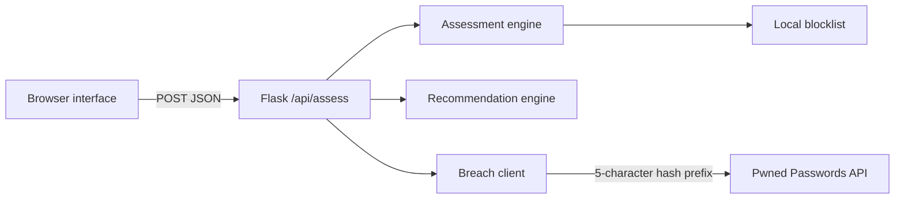

# Password Security Assessment Tool

**Live application:** [Open the deployed assessment tool](https://password-security-assessment-tool.onrender.com)

A web-based password strength and breach-exposure assessment tool developed by
**Mashkur Dademade Adetoro** as a Postgraduate Diploma in Information Technology
project at Nile University of Nigeria.

The application keeps standards alignment, project-defined comparative scoring,
and exact breach exposure as separate results so users can see *why* a password
received its outcome.

## Features

- Transparent 0–100 comparative score with a score breakdown.
- Separate NIST SP 800-63B-4-informed standards checks.
- Local screening against a documented 10,001-entry SecLists blocklist.
- Predictable-pattern checks for repetition, sequences and date-like values.
- Pwned Passwords range API lookup using a five-character SHA-1 prefix.
- Tailored recommendations based on the assessment result.
- Responsive interface for desktop and mobile screens.
- 50 automated tests covering assessment, breach and endpoint behaviour.

> **Safety notice:** Use demonstration passwords only. Never submit a password
> that protects a real account.

## Architecture



## Project structure

- `app.py` — Flask entry point and `/api/assess` endpoint.
- `core/assessment.py` — standards-informed checks and transparent score.
- `core/breach.py` — Pwned Passwords five-character hash-prefix lookup.
- `core/recommendations.py` — maps findings to corrective actions.
- `templates/index.html` — application interface.
- `static/` — browser behaviour and styling.
- `data/common_passwords.txt` — locally loaded SecLists common-password corpus.
- `data/README.md` — blocklist source, size, licence and update procedure.
- `tests/` — automated assessment, breach-response and endpoint tests.
- `evaluation/` — local benchmark and zxcvbn comparison utilities.

## Run locally

```bash
python3 -m venv .venv
source .venv/bin/activate
python3 -m pip install -r requirements.txt
python3 app.py
```

Open `http://127.0.0.1:5000` in a browser.

## Run tests

```bash
pytest -q
```

For a repeatable local-processing benchmark with the external service mocked:

```bash
python3 -m evaluation.benchmark_local
```

For the separate zxcvbn comparison, install the evaluation-only dependency and
run the comparison script:

```bash
python3 -m pip install -r requirements-evaluation.txt
python3 -m evaluation.compare_zxcvbn
```

## Deploy on Render

The repository includes a `render.yaml` Blueprint. After connecting the GitHub
repository to Render, create a Blueprint or Web Service using:

- Build command: `pip install -r requirements.txt`
- Start command: `gunicorn app:app`

No secret environment variables are required.

## Security and privacy boundary

The browser sends the submitted demonstration password in a JSON request to
the Flask `/api/assess` endpoint. The Flask process receives the plaintext
value in memory so it can apply the local scoring rules and compute the SHA-1
digest required by the Pwned Passwords range service. The application does not
intentionally write the password, request body or full digest to a database,
file, URL, browser storage or assessment history.

Only the first five hexadecimal characters of the SHA-1 digest are sent from
Flask to the external Pwned Passwords service. Returned hash suffixes are
compared inside the Flask process. This protects the full password and full
hash from the external service, but it does not remove the trust boundary
between the browser and the application server. The public deployment uses
HTTPS and a production WSGI server. Browser-local scoring and hashing would be
a stronger future design because it would prevent the application server from
receiving plaintext input.

## Scoring and standards boundary

The 0–100 weights, deductions and bands are project-defined comparison rules,
not an official NIST score. NIST SP 800-63B-4 informs the separate standards
checks: at least 15 characters for a single-factor password, at least 8 when a
password is used only as part of multi-factor authentication, screening
against a blocklist, acceptance of spaces and Unicode, and no mandatory
character-composition rule. The score gives graduated length credit below 15
characters for comparison, but the interface still reports that such a value
does not meet the single-factor threshold.

## Technology stack

- Python and Flask
- HTML, CSS and JavaScript
- Requests for the external range query
- Pytest for automated verification
- Gunicorn for production serving

## Academic and source acknowledgement

The application is informed by NIST SP 800-63B-4 and OWASP password-security
guidance. Breach exposure is checked through the Have I Been Pwned Pwned
Passwords range service. The local common-password corpus comes from SecLists
and retains its accompanying licence information in `data/`.
